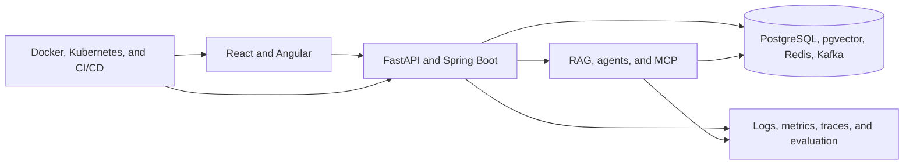

# Santhosh | AI Full-Stack Engineer

I focus on AI applications, secure backend systems, modern web interfaces, and cloud-native delivery. My engineering interests sit at the intersection of LLM/RAG systems, Java and Python services, distributed architecture, and production observability.

This portfolio is being rebuilt in public with a strict rule: planned work is labeled planned, and projects are featured only after their builds and tests have been verified.

## Current focus

### Enterprise AI Knowledge Assistant — MVP verified locally

[Enterprise RAG Assistant](https://github.com/Santhoshreddy1999/enterprise-rag-assistant)
is a secure, multi-user RAG application built with FastAPI, React,
PostgreSQL/pgvector, hybrid retrieval, source citations, deterministic offline
tests, evaluation, and containerized local delivery.

Verified: 22 backend tests at 87% coverage, 9 frontend tests, production builds,
PostgreSQL/pgvector migration, healthy containers, direct and Nginx-proxied
end-to-end retrieval/citation flows, ownership isolation, and restart
persistence. Repository publication and GitHub Actions execution are in
progress.

### Engineering Architecture Vault — existing, hardening planned

[Santhosh-projects](https://github.com/Santhoshreddy1999/Santhosh-projects) contains 287 structured notes and interactive material across Java, Spring Boot, REST, system design, DSA, JavaScript, TypeScript, Angular, React, and browser engineering.

Current status: useful learning content exists; security, link integrity, packaging, tests, and CI require improvement before it is treated as a polished release.

## Engineering areas

- **AI applications:** RAG, embeddings, semantic and hybrid search, agent workflows, MCP, tool calling, evaluation, context engineering, and AI security.
- **Backend:** Java 21, Spring Boot, Python, FastAPI, REST, PostgreSQL, Redis, Kafka, authentication, and distributed-system patterns.
- **Frontend:** Angular, React, TypeScript, RxJS, accessible component architecture, and typed API integration.
- **Platform:** Docker, Kubernetes, Helm, Terraform, GitHub Actions, AWS architecture, OpenTelemetry, Prometheus, and Grafana.
- **Practice:** clean architecture, domain modeling, API-first design, testing, secure configuration, architecture decisions, and operational runbooks.

## Portfolio architecture

## 15-project build program

The roadmap covers:

1. Enterprise AI Knowledge Assistant
2. Multi-Agent AI Orchestration Platform
3. MCP Server & AI Tool Ecosystem
4. AI-Powered Developer Copilot
5. Enterprise Java Microservices Platform
6. AI-Powered Customer Support Platform
7. Real-Time Analytics Intelligence Platform
8. AI Resume & Interview Intelligence Platform
9. AI-Powered Financial Intelligence Dashboard
10. Enterprise API Management Platform
11. AI Observability & Evaluation Platform
12. Kubernetes-Based Application Deployment Platform
13. Intelligent E-Commerce Microservices Platform
14. AI-Powered Enterprise Document Automation
15. AI Full-Stack Engineering Command Center

These are delivered in dependency order. Empty repositories are not used as progress.

## Engineering evidence

- [Initial GitHub portfolio audit](reports/github-portfolio-initial-audit.md)
- [Implementation tracker](reports/implementation-tracker.md)
- [Project catalog](reports/project-catalog.md)
- [Architecture overview](reports/architecture-overview.md)
- [Technology matrix](reports/technology-matrix.md)
- [Testing and quality report](reports/testing-and-quality-report.md)
- [Security review](reports/security-review.md)
- [Deployment report](reports/deployment-report.md)

## Working principles

- Build one end-to-end workflow before expanding breadth.
- Keep AI providers replaceable and tests independent of paid APIs.
- Treat retrieved content and agent tools as untrusted.
- Make authorization, observability, and failure behavior explicit.
- Prefer a modular monolith until service boundaries have an operational reason.
- Never claim a deployment, test result, metric, or feature without evidence.

## Progress

The public account started this transformation with five repositories, four total commits, no automated tests, no CI, and no verified deployment. The baseline is documented so future progress remains genuine and reviewable.

Professional contact links will be added only when an approved public channel is available. For now, project discussions can use the relevant GitHub repository.
