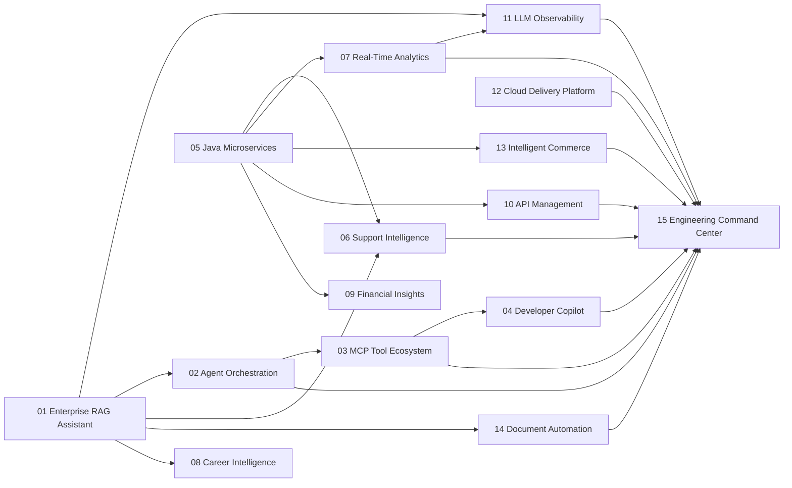
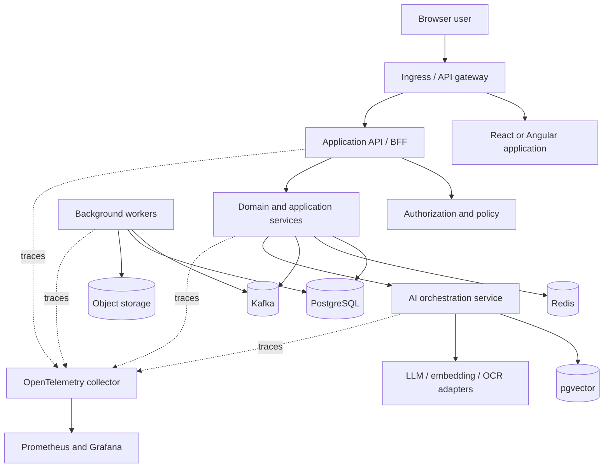
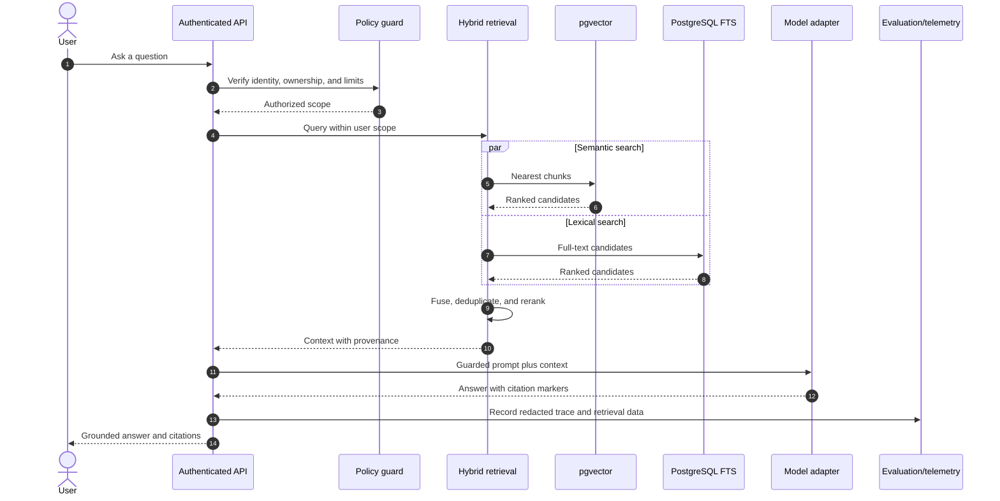
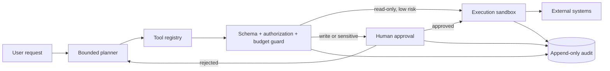
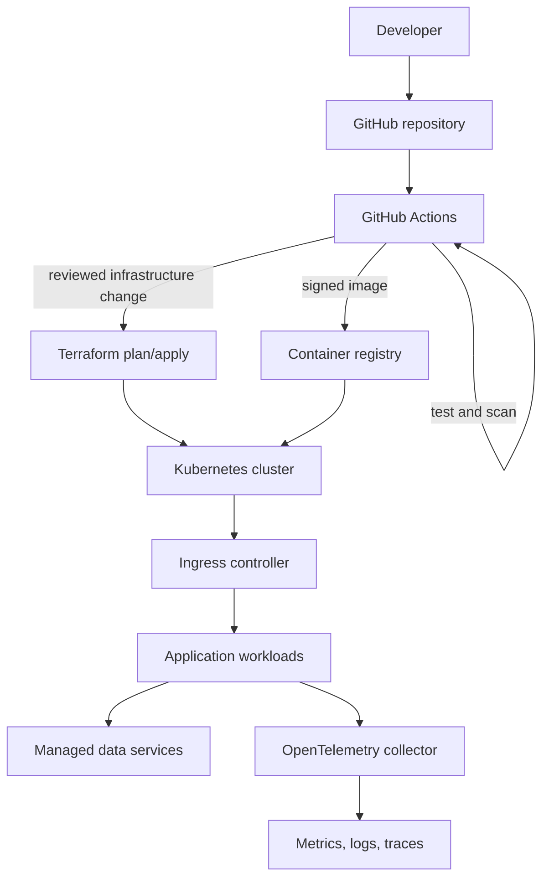

# Portfolio Architecture Overview

**Updated:** 2026-11-09
**Status:** Target architecture; implemented status is maintained in `implementation-tracker.md`.

## Architecture principles

1. **Vertical slices before platform breadth.** A complete user workflow is more valuable than many disconnected services.
2. **Modular monolith by default.** Services are separated only for independent scaling, security, ownership, or runtime reasons.
3. **Ports and adapters at volatile boundaries.** LLM vendors, vector stores, OCR engines, payment providers, and external APIs are replaceable adapters.
4. **Database ownership is explicit.** Services do not read another service's tables directly.
5. **Events communicate facts.** Commands remain explicit API calls; event contracts are versioned and idempotent.
6. **Zero-trust tool execution.** Agent and MCP tools are untrusted capabilities requiring schema validation, authorization, budgets, and audit.
7. **Observability is a product feature.** Every request and asynchronous workflow has correlated logs, metrics, and traces.
8. **Offline verification is mandatory.** Core tests must not require paid APIs or live cloud accounts.
9. **Security and privacy are designed, not added later.** Sensitive data is minimized, isolated, retained deliberately, and never used as public fixtures.
10. **Claims follow evidence.** A configured deployment is not labeled deployed; a scaffold is not labeled implemented.

## Portfolio dependency map

Reasoning:

- Project 01 establishes identity, retrieval, model-provider, and document foundations.
- Project 11 becomes the shared evaluation and trace plane.
- Projects 02 and 03 establish controlled agents and tools before the developer copilot or command center can safely write to external systems.
- Project 05 establishes Java security, events, resilience, and service operations used by later enterprise products.
- Project 12 packages proven workloads rather than deploying empty infrastructure.
- Project 15 is last because it integrates verified APIs and operational data from the rest of the portfolio.

## Reference application architecture

This is a reference, not a requirement to include every component. For example, Kafka is used only when asynchronous event ownership or replay is valuable; Redis is used only when cache, ephemeral state, rate limits, or distributed coordination are required.

## AI request lifecycle

Key controls:

- Retrieval always includes tenant/user ownership filters.
- Retrieved documents are treated as untrusted data, not instructions.
- Context and output sizes are bounded.
- Citations map to stored chunks and are validated before response.
- Telemetry excludes raw sensitive content by default.
- External providers are optional in local and CI environments.

## Agent and MCP trust boundaries

Design reasons:

- The model never receives ambient credentials.
- Tools expose narrow typed operations rather than shells or arbitrary URLs.
- Sensitive writes require explicit approval and idempotency keys.
- Time, token, recursion, network, and cost budgets prevent unbounded execution.
- Every attempted and completed tool action is auditable.

## Data architecture

### Transactional data

PostgreSQL is the default system of record because it provides:

- Strong transactions and constraints.
- JSON support without abandoning relational integrity.
- Full-text search.
- Mature migration and backup tooling.
- pgvector for the initial retrieval workloads.

MongoDB is used only in Project 13's catalog boundary where flexible product attributes are part of the learning objective.

### Vector data

Project 01 begins with pgvector to keep ownership, metadata, and vectors transactionally close. A dedicated vector database is introduced only if scale or search capabilities justify operational complexity.

### Cache and ephemeral state

Redis uses explicit key ownership, TTL, maximum size, and invalidation rules. It is not a source of truth.

### Events

Kafka contracts include:

- Event name and semantic owner.
- Schema version and compatibility policy.
- Event identifier, correlation identifier, and occurred-at timestamp.
- Idempotency behavior.
- Retention and sensitive-data classification.
- Dead-letter and replay procedure.

## Identity and authorization

- Browser clients use short-lived sessions or tokens according to the product boundary.
- Refresh credentials are held in `HttpOnly`, `Secure`, `SameSite` cookies where browser architecture permits.
- Service authorization is explicit and deny-by-default.
- Role checks do not replace object ownership checks.
- Sensitive operations produce immutable audit records.
- Secrets are loaded from environment variables locally and a secret manager in deployed environments.

## Deployment architecture

Promotion stages:

1. Local processes and unit tests.
2. Docker Compose integration environment.
3. Local Kubernetes smoke environment.
4. Optional cloud development environment with budget controls.
5. Production-like environment only when operations and cost are justified.

## CI quality path

```mermaid
flowchart LR
    Commit[Commit / pull request]
    Format[Format and lint]
    Unit[Unit tests]
    Integration[Integration and contract tests]
    Build[Production builds]
    Security[Secrets, dependencies, SAST, image scan]
    Package[Container and SBOM]
    Smoke[Compose or cluster smoke test]
    Release[Versioned release]

    Commit --> Format --> Unit --> Integration --> Build --> Security --> Package --> Smoke --> Release
```

Not every check blocks from the first commit. The tracker records which gates are implemented and verified for each project.

## Architecture documentation

Each implementation repository will contain:

- `README.md`
- `docs/architecture.md`
- `docs/security.md`
- `docs/testing.md`
- `docs/deployment.md`
- `docs/adr/`
- OpenAPI or AsyncAPI contracts where applicable
- Mermaid source kept with documentation

Architecture decision records capture context, options, decision, consequences, and review trigger. They do not retroactively invent decisions.

## Deliberate exclusions

- No service mesh in the initial portfolio; it adds operational complexity without current evidence of need.
- No custom identity provider; standards-based providers or a clearly bounded local implementation are safer.
- No multi-cloud abstraction before one cloud path is verified.
- No Kubernetes for local development when Compose is sufficient.
- No live financial integrations or real customer/tenant/resume data.
- No autonomous agent write access without an approval and audit boundary.
