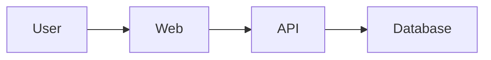

# Project Name

> One sentence describing the user, problem, and implemented outcome.

**Status:** Planned | In progress | MVP verified | Release candidate | Complete | Blocked | Archived

## Problem

Explain the concrete problem, affected users, and why it matters.

## Implemented scope

List only behavior that exists and has been exercised.

## In progress

List active work without presenting it as available.

## Planned

List roadmap items and explicitly label them as planned.

## Architecture



Explain boundaries, data ownership, consistency, and the reason for the chosen architecture.

## Technology

Explain why each material technology is appropriate. Avoid a badge wall.

## Project structure

```text
.
├── ...
└── ...
```

## Quick start

### Prerequisites

List exact supported versions.

### Configuration

```bash
cp .env.example .env
```

Document every variable without including a real credential.

### Run

Provide copyable commands from a clean clone.

## API and events

Link to OpenAPI/AsyncAPI and explain authentication.

## Data model

Include a schema diagram and migration commands.

## Testing

Provide exact unit, integration, browser, coverage, and smoke-test commands. State the latest verified result and date only after running them.

## Security and privacy

Summarize authentication, authorization, secret handling, data classification, retention, upload/tool risks, and known limitations. Link to the full threat model.

## Observability

Document logs, metrics, traces, health endpoints, dashboards, and local inspection.

## Containers and deployment

Separate:

- Local process mode.
- Docker Compose mode.
- Kubernetes/cloud configuration.
- Verified deployment status.

Do not include a live URL unless it has been tested.

## Screenshots

Add real screenshots only after the shown feature exists. Include useful alt text.

## Architecture decisions

Link to `docs/adr/`.

## Known limitations

State meaningful technical and product limitations.

## Roadmap

Use outcome-oriented milestones rather than an unbounded feature list.

## Contributing

Link to `CONTRIBUTING.md`.

## License

State the selected license, or explicitly state that no license has yet been granted.
